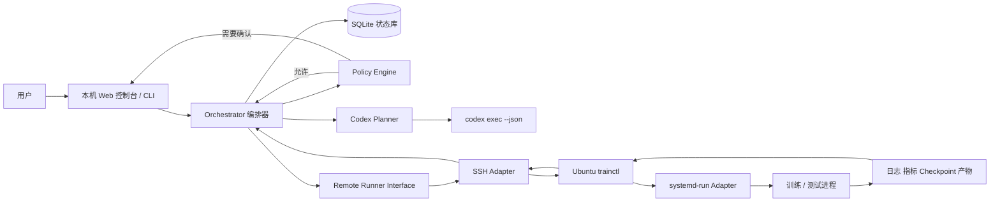
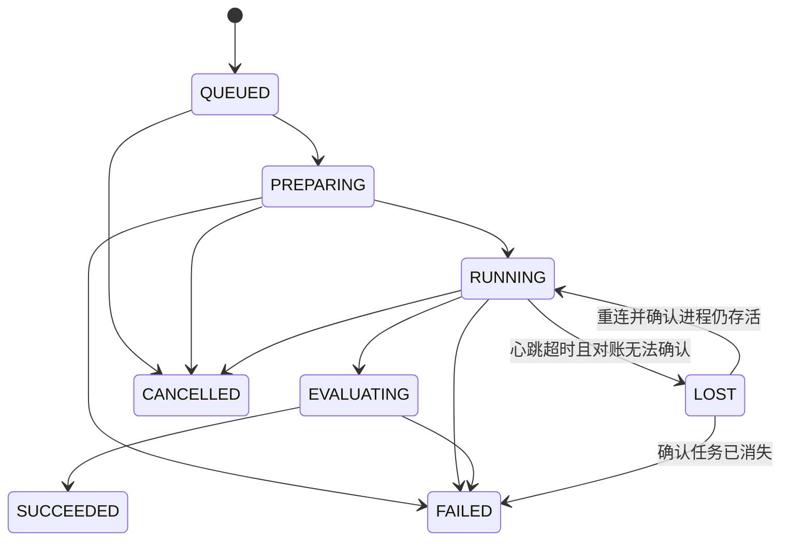

# SSH 模型训练编排系统设计方案

> 文档状态：方案草案 1.0<br>
> 日期：2026-09-04<br>
> 首期部署：Windows 主机 + 单台 Ubuntu 22.04 GPU 从机<br>
> 核心目标：本机 Codex 参与分析与决策，Ubuntu 从机可靠执行训练和测试，主机持续掌握实验状态并在安全约束内推进后续工作。

## 1. 背景与目标

模型训练经常跨越数小时或数天。仅在 SSH 终端中启动命令，会带来连接中断、状态不可恢复、实验信息分散、失败后依赖人工排查等问题。

本系统将训练工作抽象为可追踪的实验运行（Run），由本机负责控制和记录，Ubuntu 从机负责计算，Codex 负责基于证据分析结果并提出下一步动作。

### 1.1 目标

1. 本机通过 SSH 安全地提交、查询、停止和恢复 Ubuntu 上的训练任务。
2. SSH 断开或主机重启后，训练任务继续运行，并可重新接管。
3. 主机能够查看训练日志、指标、资源占用、检查点、测试结果和产物。
4. 每次运行都记录代码版本、数据版本、配置、环境和决策历史，保证可复现。
5. Codex 在训练完成或失败时自动分析证据，生成结构化的下一步建议。
6. 低风险动作可自动执行，高风险动作必须等待用户批准。
7. 第一版保持简单，同时为多从机、Slurm 和集中式监控预留扩展位置。

### 1.2 非目标

- 第一版不实现通用云平台或 Kubernetes 调度器。
- 第一版不追求毫秒级指标流；训练状态允许数秒至数十秒延迟。
- Codex 不直接获得无限制的远程 shell 或 sudo 权限。
- 系统不尝试推断未被训练代码、系统进程或监控工具暴露的内部状态。
- 第一版不自动发表、上传或删除模型和数据。

## 2. 关键设计决策

### 2.1 控制面与执行面分离

- **控制面在主机**：保存实验状态、展示监控信息、调用 Codex、执行策略审批。
- **执行面在 Ubuntu**：启动训练进程、采集本机指标、管理日志和产物。
- SSH 是第一版的传输 Adapter；核心编排逻辑不依赖 SSH 细节。

### 2.2 Codex 是决策模块，不是进程守护器

常驻编排器负责轮询、心跳、重连和状态恢复。Codex 只在出现重要事件时运行，例如：

- 训练失败；
- 训练成功并产生评估结果；
- 指标长时间无改善；
- 资源异常；
- 用户要求诊断或调整实验。

官方 OpenAI 文档说明，`codex exec` 可用于脚本、CI 和定时作业；`--json` 能输出机器可读的 JSONL 事件。因此第一版采用 `codex exec --json` 作为 Codex Adapter。后续若需要更深的客户端集成、会话历史、审批和流式 agent 事件，再评估 Codex SDK 或 App Server。

参考：

- [Codex Non-interactive mode](https://learn.chatgpt.com/docs/non-interactive-mode)
- [Codex App Server](https://learn.chatgpt.com/docs/app-server)
- [Codex Scheduled tasks](https://learn.chatgpt.com/zh-Hans/docs/automations)

### 2.3 用受控命令代替任意远程 shell

Ubuntu 端提供 `trainctl`。编排器和 Codex 只理解稳定的小型接口，不需要知道 systemd、日志文件、PID、GPU 查询和路径布局的具体实现。

这使 `trainctl` 成为一个深 Module：它用很小的 Interface 隐藏任务管理、幂等、路径校验、状态归一化和错误处理。

### 2.4 事件驱动，轮询兜底

- SSH 可用时，编排器按游标读取远端事件。
- 暂时断连时，不把运行立即判定为失败。
- 恢复连接后，从上次事件序号继续同步。
- 定时全量对账负责修复漏事件或状态漂移。

## 3. 总体架构



### 3.1 主机端 Module

| Module | Interface | 隐藏的实现复杂度 |
|---|---|---|
| `Orchestrator` | `submit`、`reconcile`、`handle_event`、`request_action` | 状态机、重试、恢复、事件排序、并发控制 |
| `RemoteRunner` | `health`、`submit`、`snapshot`、`events`、`cancel`、`fetch_artifact` | SSH 参数、超时、连接复用、远程错误映射 |
| `RunRepository` | 保存和读取 Run、Event、Decision | SQLite 事务、迁移、去重、查询 |
| `TelemetryNormalizer` | 原始遥测 → `RunSnapshot` | 日志解析、GPU/系统指标归一化、降采样 |
| `CodexPlanner` | `decide(DecisionContext) -> Decision` | Prompt 构建、JSONL 解析、超时、输出校验 |
| `PolicyEngine` | `evaluate(Decision, PolicyContext) -> Verdict` | 允许列表、预算、重试上限、审批规则 |
| `ArtifactManager` | 列出、校验、下载、归档产物 | 哈希、断点续传、保留策略、路径安全 |
| `ControlUI` | HTTP/WebSocket/CLI | 页面展示、实时更新、审批交互 |

### 3.2 Ubuntu 端 Module

| Module | Interface | 隐藏的实现复杂度 |
|---|---|---|
| `trainctl` | 稳定的 JSON/JSONL 命令接口 | 参数验证、运行目录、锁、幂等、状态汇总 |
| `ExecutionDriver` | 启动、查询、停止任务 | 首版 `systemd-run`，后续可替换 Slurm |
| `TelemetryCollector` | 返回系统与训练指标 | `nvidia-smi`、进程信息、磁盘、指标文件解析 |
| `RunStore` | 读写远端运行状态 | 原子写、事件序号、日志游标、目录权限 |
| `ArtifactCollector` | 注册和校验产物 | Checkpoint、测试报告、模型和图表索引 |

### 3.3 关键 Seam 与 Adapter

| Seam | 第一版 Adapter | 后续 Adapter |
|---|---|---|
| 远程执行 | OpenSSH | AsyncSSH、HTTPS Agent、MCP |
| 任务管理 | systemd transient unit | Slurm、Kubernetes、Ray |
| Codex 调用 | `codex exec --json` | Codex SDK |
| 数据库 | SQLite | PostgreSQL |
| 指标来源 | JSONL + `nvidia-smi` | MLflow、TensorBoard、W&B |
| 产物存储 | Ubuntu 文件系统 + SFTP | MinIO、S3、NAS |

仅当第二种实现真正出现时才固化 Seam，避免为假想变化增加浅层封装。

## 4. 领域模型

### 4.1 核心对象

#### ExperimentSpec

用户希望运行的实验定义，包含：

- 项目和代码版本；
- 工作目录与入口命令；
- Conda/venv/容器环境；
- 数据集引用与版本；
- 超参数；
- 资源需求；
- 超时、预算和重试限制；
- 成功条件和评估命令；
- 允许 Codex 自动执行的动作范围。

#### Run

一次不可变身份的执行实例。相同 ExperimentSpec 的重试必须生成新 Run，并通过 `parent_run_id` 建立关系，防止覆盖历史证据。

#### RunEvent

按单调递增 `seq` 排序的事实记录，例如状态变化、指标、日志引用、资源告警、产物生成和人工审批。

#### RunSnapshot

某一时刻的归一化视图，由 Run、最新事件、日志摘要、指标趋势、资源状态和产物组成。

#### Decision

Codex 给出的结构化判断。Decision 只表达意图，不直接产生远程副作用。

#### Action

通过 PolicyEngine 后可执行的动作，例如评估、原配置重试、从检查点恢复或请求用户批准。

### 4.2 Run 状态机



终态为 `SUCCEEDED`、`FAILED`、`CANCELLED`。`LOST` 不是终态，必须通过对账得到证据后再转换。

### 4.3 工作流状态

一次 Run 结束后，工作流进入：

```text
OBSERVING → DECIDING → POLICY_CHECK
                         ├─ AUTO_EXECUTE → OBSERVING
                         ├─ NEEDS_APPROVAL → OBSERVING / STOPPED
                         └─ COMPLETE
```

## 5. `trainctl` Interface

### 5.1 命令

```bash
trainctl health --json
trainctl submit --spec /path/to/spec.json --idempotency-key KEY --json
trainctl snapshot RUN_ID --json
trainctl events RUN_ID --after-seq N --jsonl
trainctl logs RUN_ID --stream stdout --after-offset N --json
trainctl artifacts RUN_ID --json
trainctl evaluate RUN_ID --json
trainctl cancel RUN_ID --reason TEXT --json
trainctl recover RUN_ID --json
```

所有命令遵守以下 Interface 约束：

- 成功时退出码为 `0`，stdout 只输出 JSON 或 JSONL。
- 诊断信息写入 stderr。
- 错误包含稳定的 `code`、可读 `message` 和 `retryable`。
- 产生副作用的命令必须接受幂等键。
- Run ID、文件路径和动作参数必须在 Ubuntu 端再次校验。
- 不接受任意 shell 字符串作为训练后的自动动作。

### 5.2 标准响应

```json
{
  "ok": true,
  "request_id": "req_01...",
  "data": {},
  "error": null
}
```

失败响应：

```json
{
  "ok": false,
  "request_id": "req_01...",
  "data": null,
  "error": {
    "code": "RUN_NOT_FOUND",
    "message": "Run was not found",
    "retryable": false
  }
}
```

### 5.3 远端目录约定

```text
/srv/ml-orchestrator/
├── projects/
├── datasets/
├── runs/
│   └── <run_id>/
│       ├── spec.json
│       ├── manifest.json
│       ├── status.json
│       ├── events.jsonl
│       ├── stdout.log
│       ├── stderr.log
│       ├── metrics.jsonl
│       ├── checkpoints/
│       └── artifacts/
└── tmp/
```

状态和 manifest 使用“写临时文件 → fsync → 原子重命名”，避免主机读取到半写入文件。

## 6. 实验定义示例

```yaml
schema_version: 1
name: resnet50-cifar10-baseline
project:
  repository: local-project
  git_commit: 0123456789abcdef
runtime:
  environment: conda
  environment_name: torch
  workdir: /srv/ml-orchestrator/projects/image-classifier
command:
  argv:
    - python
    - train.py
    - --config
    - configs/baseline.yaml
resources:
  gpu_count: 1
  max_gpu_memory_mb: 22000
  max_duration_seconds: 43200
outputs:
  metrics_file: outputs/metrics.jsonl
  checkpoint_glob: outputs/checkpoints/*.pt
evaluation:
  argv:
    - python
    - evaluate.py
    - --checkpoint
    - "${BEST_CHECKPOINT}"
success:
  required_metrics:
    val_accuracy:
      min: 0.90
automation:
  max_attempts: 3
  allowed_actions:
    - wait
    - evaluate
    - retry_same
    - resume_checkpoint
  require_approval:
    - modify_hyperparameters
    - install_dependency
    - increase_budget
```

`command.argv` 使用参数数组而不是 shell 字符串，以降低转义和命令注入风险。

## 7. 遥测与“掌握一切情况”

“掌握一切”定义为系统能够采集并持久化下列可观测事实，而不是推断训练程序未暴露的内部状态。

| 类别 | 信息 | 建议采样 |
|---|---|---|
| 生命周期 | 状态、PID、systemd unit、启动时间、退出码 | 状态变化时 |
| 日志 | stdout、stderr、异常栈、最近日志游标 | 2–5 秒 |
| 训练指标 | epoch、step、loss、accuracy、学习率、吞吐量 | 每 step 写入，主机降采样 |
| GPU | 利用率、显存、温度、功耗、进程 | 5–10 秒 |
| 系统 | CPU、内存、磁盘、负载 | 10–30 秒 |
| 复现信息 | Git SHA、dirty 状态、配置哈希、数据版本、依赖快照 | 启动时 |
| 产物 | checkpoint、最佳模型、评估报告、图表、哈希 | 生成时 |
| 决策 | 输入证据、Codex 输出、策略结论、用户审批 | 每次决策 |

训练程序至少要把指标写成 JSONL：

```json
{"time":"2026-09-04T02:00:00Z","step":1200,"epoch":3,"loss":0.421,"val_accuracy":0.873,"lr":0.0003}
```

## 8. Codex 决策协议

### 8.1 输入上下文

`CodexPlanner` 每次只发送完成决策所需的最小证据：

- 工作流目标和完成标准；
- 当前 ExperimentSpec；
- 最新 RunSnapshot；
- 新增日志和异常摘要；
- 指标趋势与基线对比；
- 已执行动作和历史结果；
- 剩余重试次数、时间预算和 GPU 预算；
- 允许动作列表及必须审批的动作。

不把 SSH 私钥、API key、数据凭据或完整敏感数据放入 Prompt。

### 8.2 输出结构

```json
{
  "schema_version": 1,
  "classification": "recoverable_failure",
  "summary": "训练因 CUDA OOM 退出，错误在首次验证阶段稳定复现。",
  "evidence": [
    "exit_code=1",
    "stderr contains CUDA out of memory",
    "peak_gpu_memory_mb=24112"
  ],
  "next_action": {
    "type": "request_approval",
    "params": {
      "proposed_action": "modify_hyperparameters",
      "changes": {"batch_size": 16}
    },
    "reason": "降低 batch size 可能使显存峰值回到限制内"
  },
  "confidence": 0.92,
  "requires_approval": true
}
```

### 8.3 允许的动作类型

- `wait`
- `evaluate`
- `retry_same`
- `resume_checkpoint`
- `run_test`
- `request_approval`
- `complete`
- `stop_workflow`

修改配置不是任意文本命令，而是针对允许字段生成结构化补丁，再由 PolicyEngine 校验范围。

### 8.4 Codex 运行方式

第一版调用形式：

```powershell
codex exec --json --sandbox workspace-write "<decision prompt>"
```

编排器解析 JSONL 事件并保存：

- Codex thread ID；
- turn 开始与结束；
- 命令和工具调用；
- 最终 Decision；
- token 使用和失败信息。

Codex 调用失败不能改变 Run 的真实状态。编排器可有限次数重试分析，超过上限后转为 `NEEDS_APPROVAL`。

## 9. 安全与权限

### 9.1 SSH

- 创建专用 Linux 用户 `mlrunner`，默认无 sudo。
- 使用独立 SSH 密钥，并固定 `known_hosts`。
- 开启 `BatchMode=yes` 和 `StrictHostKeyChecking=yes`。
- 为状态查询和任务提交设置不同超时。
- 条件允许时，用 `authorized_keys` 限制来源 IP、端口转发和可执行命令。
- 密钥由本机 SSH agent 或受保护文件持有，不进入项目仓库。

### 9.2 自动化权限矩阵

| 动作 | 默认策略 |
|---|---|
| 查询状态、日志、指标和产物清单 | 自动允许 |
| 执行只读评估和测试 | 自动允许 |
| 在预算内原配置重试 | 自动允许，受次数限制 |
| 从已登记 checkpoint 恢复 | 自动允许 |
| 修改允许范围内的超参数 | 首期要求批准 |
| 安装依赖、修改系统配置、使用 sudo | 必须批准 |
| 增加 GPU/时间/费用预算 | 必须批准 |
| 删除数据或模型、覆盖历史产物 | 必须批准或禁止 |
| 上传、发布或对外共享模型 | 必须批准 |

### 9.3 强制护栏

- 每个工作流有最大运行时间、GPU 时间、重试次数和磁盘配额。
- 同一 GPU 默认只允许一个训练任务，除非显式配置共享。
- 所有副作用记录审计事件。
- 配置变更必须形成 diff，并保留父 Run。
- 支持全局暂停、取消当前 Run 和禁用自动决策三个紧急开关。
- 日志进入 Codex 前执行密钥和令牌脱敏。

## 10. 可靠性设计

1. **幂等提交**：网络超时后重复提交不会产生两个训练任务。
2. **事件序号**：每个 Run 的事件拥有严格递增 `seq`；主机按 `(run_id, seq)` 去重。
3. **运行租约**：Ubuntu 写心跳；主机将超时先标为 `LOST`，而非直接失败。
4. **周期对账**：编排器重新查询所有非终态 Run，修复本地与远端状态差异。
5. **断点同步**：日志、事件和产物使用 offset、seq 或哈希恢复传输。
6. **原子状态**：远端状态文件原子替换，本地数据库使用事务。
7. **进程独立**：训练由 systemd 管理，不依赖 SSH 会话存活。
8. **不可变历史**：重试产生新 Run；旧日志、配置和产物不被覆盖。
9. **时间统一**：内部使用 UTC，界面按用户时区显示。
10. **可降级运行**：Codex 暂不可用时，训练监控和手动操作仍可使用。

## 11. 端到端流程

### 11.1 提交训练

1. 用户在本机选择 ExperimentSpec。
2. Orchestrator 校验配置和本地策略。
3. RemoteRunner 上传规范并调用 `trainctl submit`。
4. `trainctl` 记录 manifest，创建 systemd unit 并返回 Run ID。
5. Orchestrator 保存 Run 和初始事件。

### 11.2 运行监控

1. Orchestrator 按游标读取事件和日志。
2. TelemetryNormalizer 形成 RunSnapshot。
3. 数据写入 SQLite，并推送到 Web 控制台。
4. 出现断连时退避重试；恢复后继续同步。

### 11.3 成功处理

1. 训练退出码为 0。
2. 执行评估命令并验证必需产物。
3. 将指标、评估和产物 manifest 交给 CodexPlanner。
4. Codex 判断是否满足成功条件，或建议下一组实验。
5. PolicyEngine 自动执行允许动作，或请求用户批准。

### 11.4 失败处理

1. 收集退出码、异常栈、最后指标、GPU 和磁盘状态。
2. 先用确定性规则分类常见错误，如 OOM、磁盘不足、代码异常和超时。
3. Codex 基于完整证据生成诊断和下一步动作。
4. PolicyEngine 检查预算、重试次数和权限。
5. 新运行通过 `parent_run_id` 关联失败运行，并保留全部证据。

## 12. 用户界面

第一版 Web 控制台包含四个页面：

### 12.1 总览

- 从机在线状态；
- GPU、CPU、内存和磁盘；
- 正在运行、等待审批、最近失败的 Run；
- 全局暂停和刷新操作。

### 12.2 Run 详情

- 当前状态、运行时间和进度；
- loss/accuracy/学习率曲线；
- GPU 和显存曲线；
- 可搜索日志；
- 配置、代码版本和数据版本；
- checkpoint 和产物下载。

### 12.3 决策与审批

- Codex 判断、证据和置信度；
- 即将执行的结构化变更；
- 预计资源影响；
- 批准、拒绝、修改后批准。

### 12.4 历史与对比

- Run 父子关系；
- 配置 diff；
- 关键指标比较；
- 决策和人工操作审计时间线。

## 13. 技术选型

### 13.1 主机

- Python 3.12；
- FastAPI + Uvicorn；
- Pydantic；
- SQLAlchemy + SQLite；
- `asyncio.create_subprocess_exec` 调用系统 OpenSSH；
- `codex exec --json`；
- 前端首期使用简单服务端页面或轻量 React，避免阻塞核心能力。

优先复用 Windows OpenSSH 的密钥、agent 和 `known_hosts`。只有出现大量并发连接需求时，再考虑 AsyncSSH Adapter。

### 13.2 Ubuntu 22.04

- Python 3.10；
- Typer 或 argparse 实现 `trainctl`；
- systemd transient unit 管理训练；
- `nvidia-smi` 采集 NVIDIA GPU 指标；
- JSON/JSONL 保存状态和指标。

若使用 `systemd --user`，部署阶段需要确认用户 lingering 配置，使用户退出 SSH 后任务仍由 user manager 管理。也可以由管理员一次性安装受限的 system service。

## 14. 配置文件

主机配置建议放在不含秘密的 `config.yaml`：

```yaml
database_url: sqlite:///data/orchestrator.db
polling:
  active_seconds: 5
  idle_seconds: 30
  reconcile_seconds: 60
workers:
  ubuntu-gpu-01:
    ssh_host: ml-worker
    remote_root: /srv/ml-orchestrator
    max_parallel_runs: 1
codex:
  mode: exec
  timeout_seconds: 900
policy:
  max_attempts_per_workflow: 3
  require_approval_for_config_changes: true
```

SSH 地址、用户和密钥路径优先写入本机 `~/.ssh/config`。凭据只使用环境变量、SSH agent 或操作系统凭据存储。

## 15. 测试策略

### 15.1 Module 测试

- Run 状态机合法与非法转换；
- PolicyEngine 的权限、预算和重试规则；
- Codex Decision JSON 校验和容错；
- 事件去重、乱序处理和日志游标；
- 路径穿越、命令注入和敏感信息脱敏。

### 15.2 Adapter 合约测试

同一套 RemoteRunner 合约测试同时运行在：

- 内存 Fake；
- 本地进程 Fake；
- Ubuntu 22.04 SSH 测试环境；
- 未来的 Slurm Adapter。

### 15.3 端到端测试

- 正常训练并评估成功；
- Python 异常退出；
- CUDA OOM；
- 磁盘空间不足；
- SSH 中断并恢复；
- 主机编排器重启并接管；
- 重复提交不产生双任务；
- Codex 超时或输出非法 JSON；
- 需要审批时不执行动作；
- 达到预算或重试上限时停止。

## 16. 分阶段实施计划

### 阶段 0：连通性验证（0.5–1 天）

- 配置 SSH key 和主机别名；
- 验证 Ubuntu、Python、systemd、GPU 和磁盘；
- 输出一份机器能力快照。

**验收**：主机可非交互运行只读命令，且 host key 已固定。

### 阶段 1：只读监控（1–2 天）

- 实现 `trainctl health/snapshot/logs`；
- 主机保存状态和遥测；
- 提供 CLI 查看训练状态。

**验收**：能观察一个人工启动的训练，并在 SSH 重连后继续读取。

### 阶段 2：受控任务生命周期（2–4 天）

- 实现提交、取消、事件和产物；
- 用 systemd 管理训练；
- 加入幂等、心跳和周期对账。

**验收**：SSH 和主机进程退出后训练不受影响，恢复后状态一致。

### 阶段 3：Codex 只建议模式（1–2 天）

- 实现 CodexPlanner；
- 固定 Decision JSON Schema；
- 保存证据、输出和 token 使用；
- 所有建议只展示，不自动执行。

**验收**：成功、代码异常、OOM 和超时都能产生可审核建议。

### 阶段 4：护栏内自动化（2–4 天）

- 实现 PolicyEngine 和审批；
- 开放评估、原配置重试、checkpoint 恢复；
- 加入预算、重试和紧急停止。

**验收**：允许动作可自动闭环，未授权动作不会执行。

### 阶段 5：Web 控制台（2–5 天）

- 总览、Run 详情、指标曲线、日志、产物和审批；
- WebSocket 推送重要事件。

**验收**：无需打开 SSH 即可完成日常操作和审计。

### 阶段 6：多从机与调度扩展（按需）

- 多 Worker 注册和能力匹配；
- 并发与队列；
- Slurm Adapter；
- PostgreSQL 和对象存储。

## 17. MVP 完成标准

第一版满足以下条件即可投入个人科研使用：

- 一条命令提交训练，并获得唯一 Run ID；
- 主机重启和 SSH 断连不会终止远端训练；
- 能查看实时日志、核心指标和 GPU 状态；
- 每个 Run 保存代码 SHA、配置、退出码和产物 manifest；
- 训练结束后自动运行评估；
- 失败后 Codex 生成带证据的结构化诊断；
- 自动重试不超过配置次数与资源预算；
- 修改超参数、安装依赖、删除或发布内容前必须审批；
- 所有自动与人工动作可审计；
- 具备一键停止当前工作流的能力。

## 18. 首次部署前需要确认的信息

这些信息不会阻塞代码骨架开发，但会影响实际连接和运行配置：

1. Ubuntu 从机的 IP/域名、SSH 端口与登录用户；
2. GPU 型号、数量和驱动/CUDA 版本；
3. 训练框架以及现有训练、测试、评估命令；
4. 项目如何同步到从机：Git、rsync、共享盘或已存在目录；
5. Python 环境：Conda、venv、Docker 或系统 Python；
6. 是否已有 TensorBoard、MLflow 或 W&B；
7. 首批允许自动执行的动作和资源上限；
8. 是否允许管理员一次性配置专用用户、目录和 systemd 权限。

## 19. 推荐的仓库结构

```text
cross-computer-ssh/
├── README.md
├── pyproject.toml
├── config.example.yaml
├── schemas/
│   ├── experiment-spec.schema.json
│   └── decision.schema.json
├── src/
│   ├── controller/
│   │   ├── orchestrator.py
│   │   ├── domain.py
│   │   ├── policy.py
│   │   ├── repository.py
│   │   ├── telemetry.py
│   │   ├── codex_planner.py
│   │   └── adapters/
│   │       ├── ssh_runner.py
│   │       └── codex_exec.py
│   └── trainctl/
│       ├── cli.py
│       ├── execution.py
│       ├── run_store.py
│       ├── telemetry.py
│       └── artifacts.py
├── web/
├── tests/
│   ├── unit/
│   ├── contract/
│   └── integration/
└── deploy/
    ├── ubuntu/
    └── windows/
```

先实现领域模型、`trainctl` Interface 和 Fake Adapter，再连接真实 SSH。这样状态机、策略与 Codex 决策流程可以在没有 GPU 从机时完成测试。
